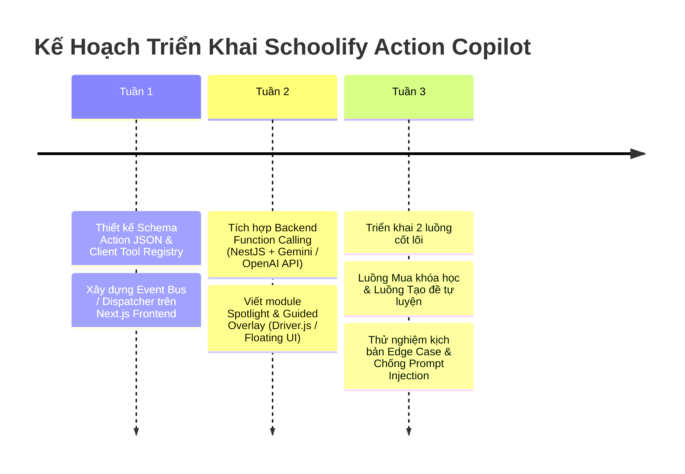

# KẾ HOẠCH PHÁT TRIỂN: SCHOOLIFY AI ACTION COPILOT
## (NÂNG TẦM CHATBOT THÔNG THƯỜNG THÀNH TRỢ LÝ HÀNH ĐỘNG CLIENT-SIDE INTERPRETER)

---

## 1. TẦM NHÌN & ĐỘT PHÁ CÔNG NGHỆ (THE PARADIGM SHIFT)

### 1.1. Thực trạng & Nỗi thất vọng của "Chatbot thông thường":
- Hầu hết các chatbot hiện nay chỉ là **"Text-only FAQ"**: Người dùng hỏi cách đăng ký, bot ném ra 1 đoạn text dài ngoằng: *"Bước 1 vào Cài đặt, Bước 2 chọn Khối lớp, Bước 3 ấn Nâng cấp..."*.
- Đối với phụ huynh lớn tuổi hoặc học sinh THCS (C2) chưa rành giao diện: Đọc xong vẫn **không biết bấm vào đâu, dễ nản và thoát trang**.

### 1.2. Đột phá của Schoolify Action Copilot:
- Chuyển từ **"Hướng dẫn bằng mồm (Passive Chatbot)"** sang **"Làm hộ bằng hành động (Active Copilot Agent)"**.
- AI đóng vai trò như một **người gia sư / nhân viên tư vấn ngồi cạnh cầm tay chỉ việc**:
  - Phụ huynh nói: *"Tôi muốn mua khóa ôn thi vào 10 môn Toán cho con"* -> Copilot **tự chuyển trang, lọc đúng môn Toán lớp 9, mở modal thanh toán và điền sẵn thông tin**.
  - Học sinh nói: *"Em học lớp 7, học lực trung bình môn Lý, sắp thi giữa kỳ muốn luyện đề"* -> Copilot **tự tạo bộ đề thi 15 phút bám sát SGK Kết nối tri thức và dẫn học sinh vào thẳng phòng thi**.

---

## 2. KIẾN TRÚC KỸ THUẬT: CLIENT-SIDE TOOL CALLING & INTENT DISPATCHER

Mô hình hoạt động dựa trên cơ chế **Function Calling (Tools) an toàn**:

```
┌────────────────────────────────────────────────────────────────────────┐
│                        USER (Phụ huynh / Học sinh)                     │
│        "Đăng ký giúp tôi gói ôn thi vào 10 môn Toán lớp 9"            │
└──────────────────────────────────┬─────────────────────────────────────┘
                                   │ (Message)
                                   ▼
┌────────────────────────────────────────────────────────────────────────┐
│                      SCHOOLIFY BACKEND AI AGENT                        │
│            (Gemini 2.5 / OpenAI / Qwen 2.5 với Tool Calling)           │
│                                                                        │
│   Phân tích ý định (Intent) -> Quyết định gọi Tool:                    │
│   name: "navigate_and_select_course"                                   │
│   args: { grade: 9, subject: "TOAN", category: "VAO_10", autoBuy: true }│
└──────────────────────────────────┬─────────────────────────────────────┘
                                   │ (Structured Action JSON Payload)
                                   ▼
┌────────────────────────────────────────────────────────────────────────┐
│                    FRONTEND (NEXT.JS CLIENT COPILOT)                   │
│                                                                        │
│   1. Action Dispatcher: Nhận Action JSON                              │
│   2. Next.js Router: Điều hướng trang `router.push('/courses/...')`    │
│   3. Highlight Element / Spotlight: Đèn chiếu sáng nút bấm cần thao tác│
│   4. State Injection: Tự động fill dữ liệu vào Form / Modal            │
│   5. Human-in-the-loop: Hiển thị hộp thoại "Bạn có muốn xác nhận?"    │
└────────────────────────────────────────────────────────────────────────┘
```

---

## 3. DANH MỤC CÁC "CLIENT TOOLS" CỦA TRỢ LÝ (TOOL REGISTRY)

Hệ thống định nghĩa danh sách các Tools mà AI được phép điều khiển trên Client:

### Tool 1: `navigate_page(route, queryParams)`
- **Mục đích:** Chuyển trang tức thì đến màn hình mong muốn.
- **Ví dụ:** Chuyển sang `/practice/create-exam` hoặc `/checkout`.

### Tool 2: `filter_and_select_course(grade, subject, target, book)`
- **Mục đích:** Tự động áp dụng bộ lọc trên sàn khóa học và chọn đúng khóa học theo nguyện vọng phụ huynh.
- **Tham số:** 
  - `grade`: 1 -> 12
  - `subject`: "TOAN", "VAN", "ANH", "VAT_LY"...
  - `target`: "VAO_10", "THPT_QG", "BAM_SAT_SGK"

### Tool 3: `create_custom_practice_exam(config)`
- **Mục đích:** Giúp học sinh chưa biết cấu hình đề tự sinh 1 đề thi vừa sức.
- **Tham số:**
  ```json
  {
    "grade": 7,
    "subject": "VAT_LY",
    "duration_minutes": 15,
    "difficulty": "MEDIUM",
    "chapters": ["Chuong_1_Am_hoc"]
  }
  ```
- **Hành vi Client:** Mở trang thi, nạp sẵn bộ câu hỏi, chuẩn bị nút "Bắt đầu làm bài".

### Tool 4: `spotlight_element(selector, message)`
- **Mục đích:** Chiếu sáng (Highlight) một nút bấm hoặc ô nhập liệu trên màn hình để học sinh/phụ huynh chú ý.
- **Ví dụ:** Chiếu đèn vào nút *"Nhận chứng chỉ"* hoặc *"Quét mã VietQR"*.

### Tool 5: `open_checkout_modal(courseId, paymentMethod)`
- **Mục đích:** Mở sẵn popup thanh toán VietQR với đúng số tiền khóa học mà phụ huynh vừa chọn, họ chỉ việc giơ điện thoại quét mã.

---

## 4. AN TOÀN BẢO MẬT: NGUYÊN TẮC "HUMAN-IN-THE-LOOP" (TUYỆT ĐỐI KHÔNG TỰ Ý TIÊU TIỀN)

Để tránh nguy cơ AI bị prompt injection hoặc tự ý thực hiện các hành động nguy hiểm:

1. **Nguyên tắc "Điền sẵn chứ không bấm chốt" (Fill, Don't Submit):**
   - AI có thể: Chuyển trang, lọc khóa học, điền mã giảm giá, chọn phương thức VietQR.
   - **NHƯNG AI KHÔNG ĐƯỢC PHÉP:** Tự bấm nút "Thanh toán ngay", tự chuyển tiền hoặc tự xóa tài khoản.
2. **Hộp thoại xác nhận tương tác trực quan (Action Card):**
   - Thay vì AI tự âm thầm làm, trong khung chat sẽ hiện 1 **Interactive Action Card**:
     > 🤖 *Em đã tạo sẵn cấu hình đề thi thử Toán 9 bám sát đề thi vào 10 (thời gian 45 phút, độ khó Trung bình - Khá) cho bạn. Bạn có muốn bắt đầu làm ngay không?*
     >
     > 👉 **[ BẮT ĐẦU LÀM BÀI THI ]** *(Nút bấm 1-click kích hoạt)*

---

## 5. KỊCH BẢN TRẢI NGHIỆM CHI TIẾT (USER JOURNEY EXAMPLES)

### Kịch bản A: Phụ huynh muốn đăng ký học cho con
- **Phụ huynh chat:** *"Tôi có con đang học lớp 9 trường Chu Văn An, cháu học môn Toán hơi yếu hình học, muốn tìm khóa luyện thi vào 10 vừa sức."*
- **Copilot hành động:**
  1. Trả lời văn bản ngắn gọn, ân cần.
  2. Đồng thời gọi tool: `navigate_page('/courses')` + `filter_and_select_course({ grade: 9, subject: 'TOAN', focus: 'HINH_HOC', level: 'CO_BAN' })`.
  3. Màn hình tự cuộn đến khóa học phù hợp nhất và chiếu đèn vàng (Spotlight) vào khóa học.
  4. Hiển thị nút: **"Mở thông tin khóa học & Xem bài học thử"**.

### Kịch bản B: Học sinh THCS (C2) không biết tạo đề luyện tập
- **Học sinh chat:** *"Tối mai em kiểm tra 1 tiết môn Hóa 8 phần Mol và tính toán hóa học, em sợ điểm kém quá bot ơi."*
- **Copilot hành động:**
  1. Động viên: *"Đừng lo, phần Mol chỉ cần nhớ 3 công thức cơ bản. Để anh/chị tạo cho em 1 đề trắc nghiệm 15 phút mức độ cơ bản để em luyện phản xạ trước nhé!"*
  2. Gọi tool: `create_custom_practice_exam({ grade: 8, subject: 'HOA', topic: 'MOL_TINH_TOAN', questions_count: 10, time: 15 })`.
  3. Hệ thống chuyển ngay sang giao diện phòng thi, hiện sẵn 10 câu trắc nghiệm vừa sức để em bắt đầu làm.

---

## 6. LỘ TRÌNH TRIỂN KHAI & PHÂN CÔNG KỸ THUẬT



---

## 7. GIÁ TRỊ VƯỢT TRỘI CHO ĐỒ ÁN & THƯƠNG MẠI
1. **Khác biệt hoàn toàn với 99% đồ án trên thị trường:** Người chấm đồ án đã quá nhàm chán với những chatbot ném text đơn thuần. Tính năng Copilot điều khiển UI trực tiếp thể hiện tư duy **Agentic AI (AI Tác nhân)** đón đầu xu thế công nghệ 2025-2026.
2. **Cực kỳ thân thiện với học sinh và phụ huynh:** Xóa bỏ hoàn toàn rào cản mù mờ công nghệ, nâng cao tỷ lệ chuyển đổi mua khóa học (Conversion Rate) và giữ chân học sinh học bài mỗi ngày.
